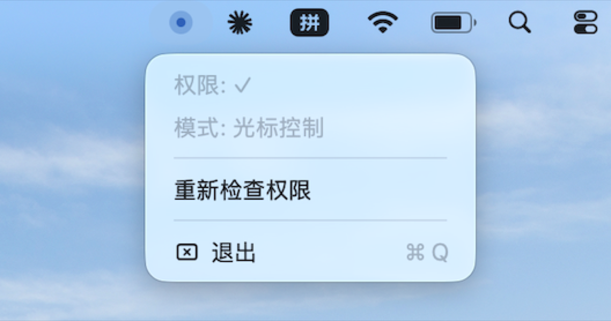
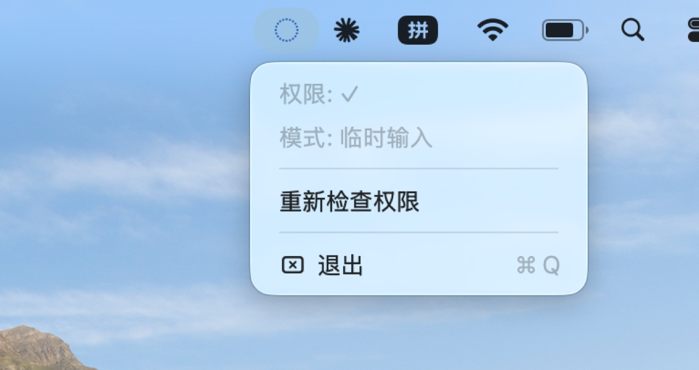

# DvP

**键盘即鼠标。** 右手放在 IJKL 上移动光标，左手控制点击和滚动——再也不用把手从键盘上挪开去摸鼠标。


> 受到 Vim「双手不离主键盘区」的理念启发。我自己用了一段时间没发现太大问题，但刚上手会有些学习成本，以后会补一篇视频教程。欢迎大家提 Issue 反馈，也欢迎 PR。

---

## 目录

- [它是怎么工作的](#它是怎么工作的)
- [菜单栏图标](#菜单栏图标)
- [三种模式](#三种模式)
- [完整键位表](#完整键位表)
- [光标加速曲线](#光标加速曲线)
- [安装](#安装)
- [快速上手](#快速上手)
- [常见问题](#常见问题)
- [许可](#许可)

---

## 它是怎么工作的

```
你的键盘  ──▶  DvP 全局监听  ──▶  翻译成鼠标事件  ──▶  注入系统
```

DvP 在 macOS 的 HID 事件层插入一个「翻译层」。当你按下 IJKL 时，它把键盘事件拦截下来，换算成对应的光标移动、点击或滚动事件，再注入回系统。整个过程在 120 Hz 下运行，移动手感丝滑。

**隐私说明：** DvP 完全在本地运行，不上传任何数据。所需的「辅助功能权限」仅用于监听全局按键和注入鼠标事件，不读取屏幕内容。

---

## 菜单栏图标

DvP 常驻在 macOS 菜单栏右上角。图标会随当前状态变化：

| 图标 | 含义 |
|------|------|
| 🔵 深蓝色实心圆 | 待机中 — 按 `Esc + I` 激活 |
| 🔘 深蓝色录制圈 | 光标模式 — IJKL 正在控制光标 |
| 💠 深蓝色虚线圆 | 输入模式 — 临时恢复键盘打字 |
| ⚫ 灰色空心圆 | 未授权 — 请到系统设置授予辅助功能权限 |



点击图标会弹出菜单，可以看到：
- 当前权限状态（✓ 或 ✗）
- 当前模式（待机 / 光标控制 / 临时输入）
- 重新检查权限（授权后点这个就能启动）
- 退出 DvP

---

## 三种模式

DvP 有三个模式，用两个快捷键在它们之间切换：

```
                    Esc + I
      待机 (Normal) ◄──────► 光标模式 (Cursor)
                                │
                                │  U
                                ▼
                          输入模式 (Input)
                                │
                                │  Esc + U
                                ▼
                           光标模式 (Cursor)
```

### 待机模式

默认状态。键盘完全正常，DvP 不干涉任何输入。菜单栏显示深蓝色实心圆。

### 光标模式

DvP 接管键盘——你的按键不再输入文字，而是被翻译成鼠标操作。菜单栏显示深蓝色录制圈。

### 输入模式

临时恢复键盘打字。比如你在浏览网页时需要输入账号密码：按 `U` 进入输入模式，打完字后按 `Esc + U` 回到光标模式。菜单栏显示深蓝色虚线圆。



---

## 完整键位表

所有快捷键仅在**光标模式**下生效。建议把右手食指放在 `J`（有凸点）上，其余手指自然覆盖 `I` `K` `L`。

### 光标移动 — 右手

| 按键 | 方向 | 说明 |
|------|------|------|
| `I` | ↑ 上 | |
| `J` | ← 左 | |
| `K` | ↓ 下 | |
| `L` | → 右 | |
| `;` | 加速 | 按住时速度翻倍（分号键，右手小指） |
| `H` | 瞬移 | 光标直接跳到屏幕正中央 |

### 鼠标点击 — 左手

| 按键 | 等价操作 | 说明 |
|------|----------|------|
| `Space` | 左键单击 | 大拇指，最常用 |
| `N` | 右键单击 | |
| `M` | 中键单击 | 浏览器里关闭标签页 |
| `O` | Enter 键 | 确认 / 回车 |

### 方向键与滚动 — 左手

| 按键 | 动作 |
|------|------|
| `W` `A` `S` `D` | ↑ ← ↓ → 方向键 |
| `Ctrl + W/S` | 垂直滚动（上下翻页面） |
| `Ctrl + A/D` | 水平滚动（网页左右滑动） |

### 模式切换

| 按键 | 功能 |
|------|------|
| `Esc + I` | 待机 ↔ 光标模式（**开关机**） |
| `U` | 光标 → 输入模式 |
| `Esc + U` | 输入 → 光标 |

---

## 光标加速曲线

DvP 使用**三次方加速算法**。简单说：

- **轻触（< 100ms）：** 光标几乎不动，适合像素级微调
- **短按（200–500ms）：** 平缓移动，适合点击按钮
- **长按（1s+）：** 速度起飞，快速跨屏

加之上限达 **30 倍**速，从屏幕左边到右边不需一秒。如果实在嫌慢，按下 `H` 直接瞬移到屏幕中央。

加速参数可在 [`Sources/CursorEngine.swift`](Sources/CursorEngine.swift) 中调整。

---

## 安装

### 系统要求

- macOS 14.0 Sonoma 或更高
- Apple Silicon 或 Intel Mac

### 方法一：下载（推荐）

从 [Releases](../../releases) 页面下载最新版 `.app`（尚未发布第一个 Release，请先自行编译）。

下载后拖到 `/Applications/` 文件夹，双击运行。首次启动会弹窗要求辅助功能权限。

> ⚠️ macOS 可能会提示「无法验证开发者」。到**系统设置 → 隐私与安全性**中点击「仍要打开」。

### 方法二：从源码编译

```bash
# 克隆仓库
git clone git@github.com:PeterkingPanpan/DvP.git
cd DvP

# Release 编译（优化过的）
swift build -c release

# 复制到 Applications
cp .build/release/DvP /Applications/

# 首次启动
open /Applications/DvP.app 2>/dev/null || /Applications/DvP
```

### 授予权限

首次运行 DvP 会自动弹窗。如果没有弹窗，手动操作：

1. 打开 **系统设置 → 隐私与安全性 → 辅助功能**
2. 找到 DvP（或 wasd-cursor），打勾
3. 点击菜单栏 DvP 图标 → **重新检查权限**

---

## 快速上手

第一次用建议这样练习：

1. 点菜单栏图标，确认权限 ✓，模式显示「待机」
2. 把右手放在 `IJKL`，食指摸到 `J` 的凸点
3. 按 `Esc + I`，看到图标变成录制圈
4. 试试 `IJKL` 移动光标，感受力度
5. 把光标移到桌面上一个文件夹，按 `Space` 点一下
6. 打开一个网页，用 `W` `A` `S` `D` 试试滚动
7. 按 `Esc + I` 退回待机模式

**练习建议：** 每天花 10 分钟用 DvP 替代鼠标做日常操作，三天就能上手。前期如果手忙脚乱，那是正常的——就像第一次用 Vim。

---

## 常见问题

### 光标撞到屏幕边缘卡住了？

在边缘按住反方向约 0.1 秒后恢复正常。这是已知问题，下个版本会完全修复。

### 想调整移动速度？

编辑 `Sources/CursorEngine.swift` 中的参数后重新编译：

| 参数 | 默认值 | 作用 |
|------|--------|------|
| `baseSpeed` | 100 | 基础速度（像素/秒） |
| `accelerationRamp` | 3.0 | 加速度（越大越快） |
| `maxSpeed` | 3500 | 速度上限 |
| `smoothing` | 0.25 | 惯性（越大越滑） |

### 菜单栏图标太暗/太亮？

深蓝色在大部分壁纸上都很清楚。如果你想要其他颜色，欢迎提 Issue 或 PR。

### 支持 Windows / Linux 吗？

目前仅支持 macOS。Windows 和 Linux 的键盘监听与事件注入 API 完全不同，未来有精力的话可以考虑移植。

---

## 许可

MIT © 2026 马祺巽 (Icarus)

---

*DvP = Devotion + Pilot。把双手献给键盘，像飞行员一样操控光标。*
